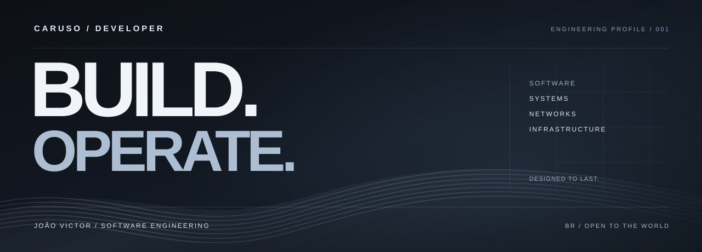
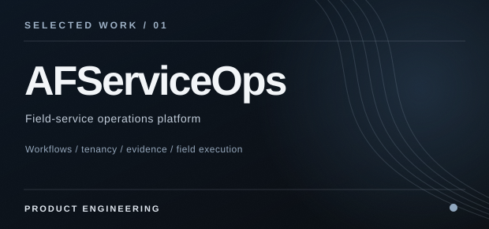
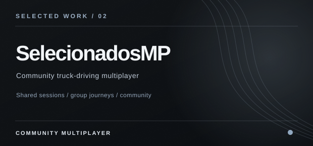
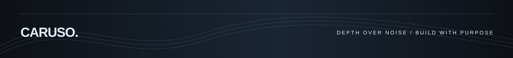

<!--
  CARUSO / ENGINEERING PROFILE
  Custom SVG artwork is maintained in assets/readme/.
  No external stats APIs, scripts, or third-party badge services at render time.
-->

  

  <a href="https://linkedin.com/in/carusodeveloper"><b>LINKEDIN</b></a>
  &nbsp;&nbsp;·&nbsp;&nbsp;
  <a href="https://github.com/CarusoDeveloper?tab=repositories"><b>REPOSITORIES</b></a>

 

01 / INTRODUCTION

## Software is only the beginning.

I'm **João Victor (Caruso)**, a Software Engineering student interested in the systems that keep products running — not just the interfaces people see.

I work across **backend development, Linux, networking and infrastructure**, connecting product decisions with real operational constraints. I care about how software is deployed, observed, maintained and improved when things stop behaving as expected.

**My direction:** build useful software, understand the systems beneath it, and take responsibility for the full technical picture.

 

02 / SELECTED WORK

## Engineering through real problems.

  
  

**AFServiceOps** — A field-service operations platform connecting administration, dispatch and technicians. The design centers on **multi-tenant boundaries, service-order lifecycles, operational workflows and evidence-based completion**. *Product / work in progress.*

**[Selecionado'sMP](https://github.com/CarusoDeveloper/HypeMultiplayer)** — An experimental multiplayer platform for Euro Truck Simulator 2, exploring **client-server coordination, real-time synchronization, launcher workflows and systems troubleshooting**. *Public repository / experimental.*

 

03 / TECHNICAL TERRITORY

## The layers I work across.

| SYSTEMS & OPERATIONS | BACKEND & PRODUCTS | NETWORKS & PLATFORM |
| :--- | :--- | :--- |
| Linux · Bash · Docker · Virtualization | C# / .NET · Python · TypeScript · SQL | TCP/IP · Routing · Switching · Troubleshooting |
| Deployment workflows · Diagnostics | APIs · Data modeling · Service workflows | PostgreSQL · Git · Cloud fundamentals |

 

04 / CURRENT DIRECTION

## Building depth, not just a stack.

<pre>
  01  SOFTWARE ENGINEERING   →   backend, architecture, product logic
  02  LINUX & OPERATIONS     →   tooling, automation, reliability
  03  NETWORKING             →   TCP/IP, routing, switching, diagnostics
  04  INFRASTRUCTURE         →   containers, deployments, cloud foundations
</pre>

I prefer simple, observable systems over unnecessary complexity. My goal is to be equally comfortable **writing the software, understanding its infrastructure and investigating its failures**.

 

05 / THE WAY I THINK

**Reliability over appearance.** The system has to work beyond the demo.

**Clarity over complexity.** A good architecture makes its trade-offs understandable.

**Ownership over abstraction.** Learn the full path from code to production.

 

  <a href="https://linkedin.com/in/carusodeveloper">Connect on LinkedIn</a>
  &nbsp;&nbsp;·&nbsp;&nbsp;
  <a href="https://instagram.com/caruso.eng">Instagram</a>

  

